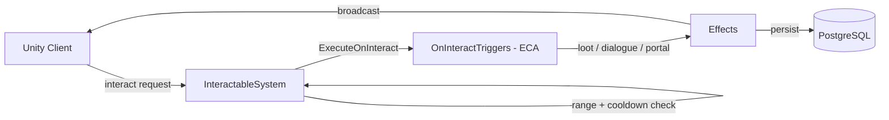

# World Interactable System (and the core interaction it builds on)

**Short description:** The scene server's handling of a player using a world interactable: validation, the
per-connection interaction guard, dispatch to the interactable's ECA triggers and to module handlers, server-authoritative
dialogue, container looting, and portal activations.

> Dialogue and containers are the [World Interactables module](../README.md)'s `WorldInteractableSystem`
> (`WorldInteractableSystem.Dialogue.cs`, `WorldInteractableSystem.Container.cs`). The interaction request, its guard and
> scene-object validation stay in the core `InteractableSystem` ([its README](../../../Server/Implementation/World/SceneServer/Interactable/README.md));
> this document describes both halves as they work together.

## Overview

**Interaction behaviour is data, not code.** There is no server-side handler registry: `InteractableSystem` validates
the request and then calls `IInteractable.ExecuteOnInteract(eventData)`, which fires the `OnInteractTriggers` authored
on the interactable prefab through the ECA trigger system. Modules add behaviour two ways: their own triggers on the
prefab (or attached at run time through `InteractableTriggers`), and the `OnPlayerInteracting` event raised just before
the triggers run.

| Partial class | Handles |
|---|---|
| `InteractableSystem.cs` | Broadcast registration, validation, ingress guard, dispatch, `OnPlayerInteracting`, NPC look-at, main-thread queue drain, `SendNewItemBroadcast` |
| `WorldInteractableSystem.Dialogue.cs` | `DialogueChoiceBroadcast`: server-authoritative dialogue sessions and the per-character choice cache |
| `WorldInteractableSystem.Container.cs` | `ContainerTakeItemBroadcast`: taking items from an open container |
| `InteractableSystem.Portal.cs` | The server's `PortalActivationStore`: reads and writes `character_portals` and `world_portal_state`, and tells clients which portals are open for them. The use of a portal is decided by `PortalGate` in the shared assembly. |

**What moved to modules** (each with its own system and README): merchants, mail and corpse loot (Commerce), ability
crafting (Ability Crafting), the group finder, dungeon finder and arenas (Matchmaking), waypoint discovery and fast
travel (Travel). The interactables themselves, placed in the world, stay in the core; without the module they open
nothing.

**Threading.** Validation, the ingress guard, trigger execution, dialogue sessions and broadcasts run on the main
thread. Database reads and writes (dialogue choices, portal activations) run on the async worker and come back through
`IInteractableSystemMainThreadQueueData`. All interaction entry points share one per-connection `IngressGuard` with a
configurable cooldown, so only one interaction is in flight per connection; stale entries are swept with bounded
cleanup.

## Configuration

| Parameter | Type | Default | Description |
|---|---|---|---|
| `maxMainThreadActionsPerFrame` | int | 100 | Actions drained from the main-thread queue per frame |
| `interactionDebounceMilliseconds` | int | 1000 | Global interaction cooldown: a player interacts with one thing at a time |
| `debounceSweepIntervalSeconds` | float | 5.0 | Seconds between bounded debounce tracker sweeps |
| `debounceEntryTtlSeconds` | float | 30.0 | Seconds before a stale debounce entry is removed |
| `debounceSweepMaxRemovals` | int | 128 | Stale entries removed per sweep and tracker |
| `worldSceneDetailsCache` | WorldSceneDetailsCache | | Scene validation and respawn lookup |
| `portalFlushIntervalSeconds` | float | 30.0 | How often unconfirmed portal activations are written again |
| `portalWorldRefreshSeconds` | float | 120.0 | How often a scene's world portal openings are re-read (openings made on another scene server) |

| Constant | Value | Description |
|---|---|---|
| `MaxActiveDialogueSessions` | 2048 | Concurrent dialogue sessions before new ones are refused |
| `MaxCachedChoiceCharacters` | 4096 | Characters with cached dialogue choices before eviction |

## Broadcast Handlers

| Broadcast | Handler | Partial | Purpose |
|---|---|---|---|
| `InteractableBroadcast` | `OnServerInteractableBroadcastReceived` | `InteractableSystem.cs` | Use an interactable |
| `DialogueChoiceBroadcast` | `OnServerDialogueChoiceBroadcastReceived` | `WorldInteractableSystem.Dialogue.cs` | Choose a dialogue option |
| `ContainerTakeItemBroadcast` | `OnServerContainerTakeItemBroadcastReceived` | `WorldInteractableSystem.Container.cs` | Take an item from a container |

## Usage

### Generic Interaction Dispatch

`OnServerInteractableBroadcastReceived(conn, msg, channel)`:

1. Validates connection, spawned object, and character.
2. Acquires ingress guard (`EndIngressGuard` in a `finally`).
3. Validates scene via `WorldSceneDetailsCache`.
4. Validates scene object via `ValidateSceneObject` (existence + same-scene check).
5. Resolves the interactable with `InteractableResolver.Resolve(sceneObject)`.
6. Calls `interactable.CanInteract(character)`, then `interactable.TryConsumeInteractRateLimit(character)`.
   Every refusal above logs at Debug with the reason (corpse / in-range / rate-limited) — the branches
   used to decline in silence, which made "I pressed E and nothing happened" undiagnosable.
7. Raises `OnPlayerInteracting(character, interactable)`. Interaction kinds intrinsic to the interactable are handled
   by whoever subscribes, before the triggers: the Commerce module opens a corpse's loot window here, so a missing
   `OnInteractTriggers` entry cannot make a creature unlootable. A throwing handler does not stop the interaction.
8. Calls `interactable.ExecuteOnInteract(new PlayerInteractionEventData(...))` to run the prefab's
   `OnInteractTriggers`. The event data carries a `SendNewItemBroadcast` callback so triggers that
   grant items can tell the client.

### Dialogue Session

**Start** (`StartDialogueSession` / `StartECADialogueSession`):
1. Ends any existing session for the character.
2. Checks bounded session capacity (`MaxActiveDialogueSessions`).
3. Evaluates start node conditions via ECA.
4. Executes start node on-enter actions.
5. Loads cached choices for the character + template.
6. Creates `DialogueSession` and broadcasts `DialogueStartBroadcast`.

**Choice** (`OnServerDialogueChoiceBroadcastReceived`):
1. Validates session exists and node matches.
2. Validates template, scene, and range (skipped for ECA sessions).
3. Validates choice index bounds.
4. Evaluates choice conditions via ECA.
5. Executes current node on-exit actions and choice on-select actions.
6. Updates choice bitmask.
7. If `NextNodeId < 0`: persists cached choices if enabled, broadcasts `DialogueEndBroadcast`.
8. Otherwise: evaluates next node conditions, executes on-enter actions, advances session, broadcasts `DialogueChoiceResultBroadcast`.

### Container Take Item

`OnServerContainerTakeItemBroadcastReceived(conn, msg, channel)`:

1. Validates connection, character, inventory controller, and ingress guard.
2. Validates scene object and interactable in range.
3. Confirms interactable is `IContainer` + `IItemContainer` with a template.
4. Removes item from container slot.
5. Calls `SendNewItemBroadcast` to add to inventory; on failure, puts item back.
6. If container is empty and `DespawnWhenEmpty` is enabled, despawns.

### Inventory Persistence

This system does not place, broadcast or persist items itself. Both entry points delegate to
`CharacterInventorySystem`, which is the one grant funnel that hands an item its database identity:

`SendNewItemBroadcast(conn, character, inventoryController, newItem)`:

1. Requires an `IPlayerCharacter`; refuses otherwise.
2. Resolves `ICharacterInventorySystem` from `Server.BehaviourRegistry`. **If it is absent the grant
   is refused** rather than persisted without a write-back — an item that never learns its id cannot
   be equipped, used or moved, so the caller's own fallback (put it back on the corpse, refund the
   purchase) is the better outcome.
3. Returns `inventorySystem.TryGrantItem(playerCharacter, newItem, InventoryType.Inventory)`.

`PersistInventoryChanges(character, changed, removed)` hands changed rows to `inventorySystem.PersistInventoryChanges` — the journalled batch. The caller has already
told the client. Same registry-absent refusal, logged as an error.

The place/broadcast/persist body used to live here and was one of three copies (quest and
achievement systems had their own); only this one wrote the identity back, which is why they were
collapsed into `CharacterInventorySystem.TryGrantItem`.

### Interactable Types

Each type is a component deriving from `Interactable` in
[`Shared/Implementation/Entity/Interactable/`](../../../Shared/Implementation/Entity/Interactable). None of them
carries interaction logic in this server system — the component supplies
identity, display metadata, `CanInteract` rules, and template references, while
the behaviour listed below is what the prefab's `OnInteractTriggers` are
conventionally wired to do.

| Interactable Type | Typical authored behaviour |
|---|---|
| `AbilityCrafter` | Opens the ability crafting UI (Ability Crafting module); NPC look-at |
| `Banker` | Sets `LastInteractableID`, opens bank UI; NPC look-at; achievement |
| `Bindstone` | Sets character `BindPosition` and `BindScene`; achievement |
| `CapturePoint` | Applies capture progress, broadcasts state, achievement on capture |
| `Container` | Builds slot data and opens the container UI; achievement |
| `DialogueInteractable` | Starts a server-authoritative dialogue session; NPC look-at |
| `DungeonEntrance` | Opens the dungeon finder UI (Matchmaking module) |
| `GatheringNode` | Rolls the weighted drop table, grants items, decrements uses, auto-despawns |
| `LoreObject` | Idempotently grants abilities / events / items |
| `Mailbox` | Opens the mail UI (Commerce module); achievement |
| `Merchant` | Opens the merchant UI with the template ID (Commerce module); NPC look-at |
| `PlotFoundation` | Housing: the placed foundation a plot's row points at; `ClaimPlotAction` buys it |
| `QuestInteractable` | Offers and turns in quests |
| `Shrine` | Heals health/mana by percentage, applies buff stacks; achievement |
| `Switch` | Toggles `ISwitchTarget` activate/deactivate; achievement |
| `Teleporter` | Teleports via direct transform or named destination; achievement |
| `Waypoint` | The Travel module attaches its `Waypoint Interact` trigger at run time (`InteractableTriggers`): `UnlockWaypointAction` and the discovery achievement. Travel is **not** an interaction: it is requested from the map, validated by the server, and the arrival runs `OnTravelTriggers` |
| `WorldItem` | Picks up the item with a concurrency guard, adjusts stack or despawns; achievement |
| `ArenaBoard` | Opens the arena panel (Matchmaking module; its season leaderboard tab is the Leaderboards module's) |
| `ArenaObjective` | A flag stand or control point; its trigger runs `InteractWithArenaObjectiveAction`, which the Matchmaking module's match coordinator scores |

Because the mapping is authored per prefab rather than compiled in, two
`Shrine` prefabs can behave differently, and a prefab whose `OnInteractTriggers`
list is empty is interactable but inert — see [Operational Checks](#operational-checks).

### Failure Semantics

- Invalid requests fail closed with no mutation.
- Scene/object/range checks prevent cross-scene and spoofed interaction attempts.
- Ability craft event selection rejects duplicates and unknown/unowned events.
- Dialogue sessions are bounded; excess sessions are rejected with a warning.
- World item pickup uses `ConcurrentDictionary` to prevent item duplication.
- Async enqueue failures are handled explicitly: known-ability and crafted-ability grants fail closed (no learn mutation, no charge on rejection); writes that must not be dropped go through `EnqueuePersistence`, which the worker admits even past its backpressure threshold.
- Main-thread completion paths revalidate runtime state before mutating or broadcasting.
- Ingress guards are always released in `finally` blocks (synchronous or async-owned).

## Operational Checks

| Check | How to Verify |
|---|---|
| Initialization success | Confirm `InteractableSystem` logs "Initialized" without errors on server startup |
| Trigger wiring | Confirm each interactable prefab has its `OnInteractTriggers` list populated; an empty list means interacting does nothing |
| Data containers available | Verify `IInteractableSystemRuntimeData` and `IInteractableSystemMainThreadQueueData` resolve from `DataContainerRegistry` |
| Dialogue start | Interact with `DialogueInteractable`; confirm `DialogueStartBroadcast` with template ID and start node |
| Dialogue choice | Send `DialogueChoiceBroadcast` with valid node/choice; confirm `DialogueChoiceResultBroadcast` or `DialogueEndBroadcast` |
| Dialogue range check | Move out of range during dialogue; confirm session ends with `DialogueEndBroadcast` |
| ECA dialogue | Trigger `DisplayDialogueAction`; confirm dialogue session starts without physical interactable |
| Dialogue session cap | Fill `MaxActiveDialogueSessions`; confirm new sessions are rejected with warning |
| Container take item | Send `ContainerTakeItemBroadcast`; confirm item appears in inventory via `InventorySetMultipleItemsBroadcast` |
| Container auto-despawn | Take last item from `DespawnWhenEmpty` container; confirm container despawns |
| Container failed pickup | Take item with full inventory; confirm item is returned to container slot |
| World item pickup | Interact with `WorldItem`; confirm item added to inventory and world item despawned |
| World item duplication guard | Interact with same `WorldItem` from two connections simultaneously; confirm only one succeeds |
| Gathering node | Interact with `GatheringNode`; confirm `GatheringNodeBroadcast` and item grant |
| Gathering node depletion | Deplete all uses; confirm node despawns |
| Capture point | Interact with `CapturePoint`; confirm `CapturePointUpdateBroadcast` with progress |
| Shrine healing | Interact with `Shrine`; confirm health/mana restored and `ShrineBroadcast` sent |
| Switch toggle | Interact with `Switch`; confirm `SwitchStateBroadcast` with toggled state |
| Bindstone | Interact with `Bindstone`; confirm `BindPosition` and `BindScene` updated |
| Teleporter | Interact with `Teleporter`; confirm character repositioned or teleported |
| Lore object | Interact with `LoreObject`; confirm `LoreObjectBroadcast` and idempotent ability grants |
| Ingress debounce | Send rapid consecutive interactions; confirm excess requests are dropped |
| Debounce sweep | Wait for `debounceSweepIntervalSeconds`; confirm stale entries are cleaned up |
| NPC look-at | Interact with NPC merchant; confirm NPC faces character and transitions to idle |
| Out-of-range interaction | Send interaction from beyond range; confirm request is rejected |
| Cross-scene interaction | Send interaction for object in different scene; confirm request is rejected |
| Main-thread queue drain | Confirm queued async results are dispatched on the main thread within `maxMainThreadActionsPerFrame` per frame |
| Async backpressure | Saturate async worker queue; confirm `TryEnqueueAsyncWork` requests are refused with a logged warning, while `EnqueuePersistence` writes are still admitted behind the backlog with a counted overflow line |
| Inventory system absent | Unregister `ICharacterInventorySystem`; confirm an item grant is refused with an error rather than persisted |
| Deinitialize cleanup | Trigger deinitialize; confirm broadcast handlers unregistered, handlers cleared, dialogue sessions cleared, and main-thread queue drained |

## Flow Diagrams

### High-Level Overview



### Generic Interaction Dispatch

```
OnServerInteractableBroadcastReceived(conn, msg, channel)
│
├─ 1. Validate connection + spawned character
├─ 2. Acquire ingress guard (global key 0)
├─ 3. Validate scene via WorldSceneDetailsCache
├─ 4. ValidateSceneObject(msg.InteractableID, characterSceneHandle)
│      ├── Existence check in SceneObject.Objects
│      └── Same-scene handle check
├─ 5. InteractableResolver.Resolve(sceneObject)
├─ 6. CanInteract(character) + TryConsumeInteractRateLimit(character)
└─ 7. RaisePlayerInteracting (modules), then interactable.ExecuteOnInteract(...)
       │
       └── (Trigger actions: broadcast, state change, achievement, etc.)
```

### Dialogue Flow

```
StartDialogueSession(character, sceneObject, dialogue)
│
├─ EndDialogueSession (close any existing)
├─ Bounded capacity check
├─ Evaluate start node conditions (ECA)
├─ Execute start node on-enter actions
├─ Load cached choices
├─ Create DialogueSession
└─ Broadcast DialogueStartBroadcast

OnServerDialogueChoiceBroadcastReceived(conn, msg, channel)
│
├─ 1. Validate connection + character + ingress guard
├─ 2. Validate session exists + node matches
├─ 3. Validate template + scene + range
├─ 4. Validate choice index bounds
├─ 5. Evaluate choice conditions (ECA)
├─ 6. Execute current node on-exit actions
├─ 7. Execute choice on-select actions
├─ 8. Update choice bitmask
└─ 9. If NextNodeId < 0:
       │    ├── Cache choices if enabled
       │    └── EndDialogueSessionWithBroadcast
       └── Else:
            ├── Evaluate next node conditions
            ├── Execute next node on-enter actions
            ├── Advance session (CurrentNodeId = NextNodeId)
            └── Broadcast DialogueChoiceResultBroadcast
```

## License

This project is subject to the FishMMO project license.
