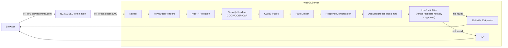

# WebGLServerASP.NET

## Table of Contents

- [Overview](#overview)
- [Supported Platforms](#supported-platforms)
- [Architecture](#architecture)
- [Directory Structure](#directory-structure)
- [Middleware Pipeline](#middleware-pipeline)
- [Key Components](#key-components)
- [Configuration](#configuration)
- [Security](#security)
- [Deployment](#deployment)
- [External Dependencies](#external-dependencies)
- [Requirements](#requirements)
- [Flow Diagram](#flow-diagram)

## Overview

ASP.NET Core static file server purpose-built for serving Unity WebGL builds to browsers. Serves static content from `wwwroot` beside the executable, or the directory selected by `ASPNETCORE_WEBROOT`, supports HTTP range requests for efficient streaming of large `.wasm`/`.data` files, and applies security headers (COOP/COEP/CSP) required for Unity 6 WebGL multi-threading (SharedArrayBuffer).

Designed to run behind NGINX as a reverse proxy (via `play.fishmmo.com`). NGINX terminates SSL and forwards requests over plain HTTP to Kestrel on localhost.

## Supported Platforms

| Target | Status |
|---|---|
| .NET 8.0 — Linux | Yes (recommended) |
| .NET 8.0 — Windows | Yes |
| .NET 8.0 — macOS | Yes |

| Client Browser | Notes |
|---|---|
| Chromium / Chrome / Edge | Full support |
| Firefox | Full support |
| Safari | Full support (Range requests required for large `.wasm`) |

| Requirement | Version |
|---|---|
| .NET SDK | 8.0+ |
| Unity WebGL build | Output placed into configured content root |
| NGINX | Recommended for production |

## Architecture

```
Browser
    |
    v HTTPS (play.fishmmo.com)
+---------+
|  NGINX  |  <- SSL termination, X-Forwarded-For/Proto
+----+----+
     | HTTP (localhost:8000)
+----v---------------------------------------+
|  Kestrel (WebGLServer)                    |
|  +-- Exception handler middleware         |
|  +-- ForwardedHeaders middleware          |
|  +-- Null-IP rejection middleware         |
|  +-- FishMMOSecurityHeaders               |
|  |   (COOP/COEP/CSP for SharedArrayBuffer)|
|  +-- CORS (Public)               |
|  +-- Rate Limiter (token bucket)          |
|  +-- UseResponseCompression               |
|  +-- UseDefaultFiles + UseStaticFiles     |
|  |   (range requests natively supported)  |
|  +-- MapControllers + /healthz            |
+--------------------------------------------+
```

## Directory Structure

```
WebGLServer/
├── Program.cs                      # Host builder, Kestrel config, middleware pipeline
├── appsettings.json                # Port and content root configuration
└── (WebGL build output)            # Unity WebGL build placed in configured content root
```

Place the Unity WebGL output (the directory containing `index.html`) in `wwwroot/` beside the server executable, or set `ASPNETCORE_WEBROOT` to its absolute path. `WebClient:ContentRootPath` is not read by the server.

## Middleware Pipeline

1. **`UseExceptionHandler`** — catches unhandled exceptions, returns structured error responses.
2. **`UseForwardedHeaders`** — trusts `X-Forwarded-For` / `X-Forwarded-Proto` from NGINX.
3. **Null-IP rejection middleware** — returns 400 if `RemoteIpAddress` is null after forwarding (proxy misconfiguration guard).
4. **`UseFishMMOSecurityHeaders`** — adds standard security headers plus `Cross-Origin-Opener-Policy: same-origin`, `Cross-Origin-Embedder-Policy: require-corp`, and a comprehensive `Content-Security-Policy` enabling Unity 6 WebGL multi-threading (SharedArrayBuffer).
5. **`UseCors`** — allows cross-origin requests from `play.fishmmo.com` (required for WebGL).
6. **`UseRateLimiter`** — token-bucket rate limiting (60 req/s replenishment, 120 burst, partitioned by real client IP).
7. **`UseResponseCompression`** — compresses wasm/octet-stream/gzip MIME types.
8. **`UseDefaultFiles`** — serves `index.html` for root requests.
9. **`UseStaticFiles`** — serves files from the configured content root with custom MIME type mappings (`.wasm`, `.unityweb`, `.bundle`, `.bin`, `.data`, `.hash`, `.webmanifest`). Supports HTTP range requests natively.
10. **`UseRouting` + `MapControllers`** — standard ASP.NET routing (for health checks and future API endpoints).

**Note:** The legacy `RangeRequestMiddleware` and `UnityOnlyMiddleware` referenced in older documentation no longer exist. ASP.NET Core's built-in `UseStaticFiles` handles range requests natively. The `ClientGate` HMAC middleware used by IPFetch/Patcher is intentionally absent here — browsers cannot add custom headers to static resource requests.

## Key Components

### `Program.cs`

Configures Kestrel (localhost-only binding, port 8000), response compression, security headers (COOP/COEP/CSP for SharedArrayBuffer), and the static file pipeline. Custom MIME type mappings are registered for WebGL-specific extensions.

### Security Headers

The server applies COOP (`same-origin`), COEP (`require-corp`), and a comprehensive CSP to enable Unity 6 WebGL multi-threading via `SharedArrayBuffer`. These headers are essential for modern Unity WebGL builds.

## Configuration

`appsettings.json`:

```json
{
  "WebServer": {
    "HttpPort": 8000
  }
}
```

| Key | Default | Purpose |
|-----|---------|---------|
| `WebServer:HttpPort` | `8000` | Kestrel listen port (localhost only) |

## Security

- **SecurityHeaders** — applies `Cross-Origin-Opener-Policy: same-origin`, `Cross-Origin-Embedder-Policy: require-corp`, and a comprehensive `Content-Security-Policy` to enable Unity 6 WebGL multi-threading via `SharedArrayBuffer`.
- **CORS** (`Public`) permits only `Cors:AllowedOrigins`. Same-origin client assets need no CORS grant. Configure browser origins on IPFetch and Patcher for cross-origin API calls.
- **ForwardedHeaders** ensures correct client IP logging when behind NGINX.
- **Rate limiting** (token bucket: 60 req/s replenish, 120 burst, partitioned by real client IP) prevents abuse.
- Kestrel binds to **localhost only** — not directly accessible from the internet.
- No authentication middleware — static content is publicly served (access control is at the NGINX layer). The `ClientGate` HMAC middleware used by IPFetch/Patcher is intentionally absent here; browsers cannot add custom headers to static resource requests.

## Deployment

1. Build the Unity WebGL project.
2. Copy the build output into the configured content root path.
3. Start the server:
   ```bash
   dotnet run --project WebGLServer/WebGLServer.csproj
   ```
4. Configure NGINX to proxy `play.fishmmo.com` to `localhost:8000`.

## External Dependencies

- **FishMMO.Logging** - structured async logging.

## Requirements

- .NET 8.0 SDK or later
- Unity WebGL build output placed in configured content root
- NGINX reverse proxy (recommended for production)

## Flow Diagram




## Content Security Policy and local WebGL hosting

The shared middleware owns CSP for all four web applications. NGINX must pass the
upstream CSP and COOP/COEP headers through; do not add another CSP at the proxy, because browsers
apply both policies. Deploy the updated applications together with the updated
`FishMMO-Setup/nginx.conf` template when using NGINX.

The WebGL profile permits WebAssembly compilation, Unity's blob-based decompression
scripts/workers, and the exact inline startup scripts in the served HTML using
SHA-256 hashes. Hashes are generated from the current HTML on each HTML response;
there is no manual pin update after rebuilding the client and no script
`unsafe-inline` or JavaScript `unsafe-eval` grant. Inline styles remain permitted
for the Unity template and control panel. API responses use a deny-by-default CSP;
the control panel uses same-origin scripts and connections without Unity permissions.

`GameHost` is a hostname/IP without a scheme or port. It allows HTTPS WebTransport
to that host on the dynamically allocated game ports.
`ContentSecurityPolicy:ConnectOrigins` lists additional explicit API/CDN origins.
Production accepts HTTPS origins only; Development also accepts HTTP loopback
origins. Paths, credentials and CSP fragments are rejected at startup. The local
template includes API ports 8080, 8088 and 8090 on localhost and 127.0.0.1.
Add each actual cross-origin asset/API host to this list if your deployment differs.
CSP does not provision transport certificates or replace API CORS configuration.

For the current local build, run:

```bash
cd /home/jim/Dev/FishMMO-Dev/Builds/WebGLServer/Debug/net8.0
env FISHMMO_ENVIRONMENT=Development \
  ASPNETCORE_WEBROOT="/home/jim/Dev/FishMMO-Dev/Builds/Client/WebGL Demo/FishMMO WebGL/FishMMO.exe" \
  ./WebGLServer
```

Open `http://localhost:8000`. `FishMMO.exe` here is the build directory containing
`index.html`. The API services' `Cors:AllowedOrigins` must include
`http://localhost:8000` (and `http://127.0.0.1:8000` if using that address).
Restart applications after updating their assemblies or configuration. A Unity
client rebuild is not needed for these server header changes.

Run regression checks with:

```bash
dotnet run --project FishMMO-WebServers/Tools/SecurityHeaders.Tests
```
